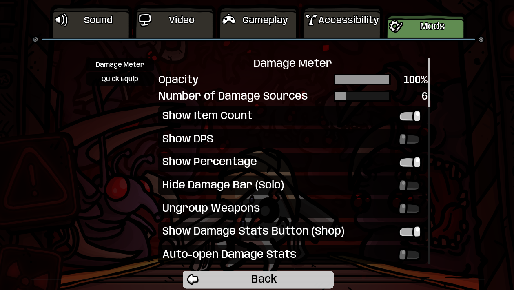
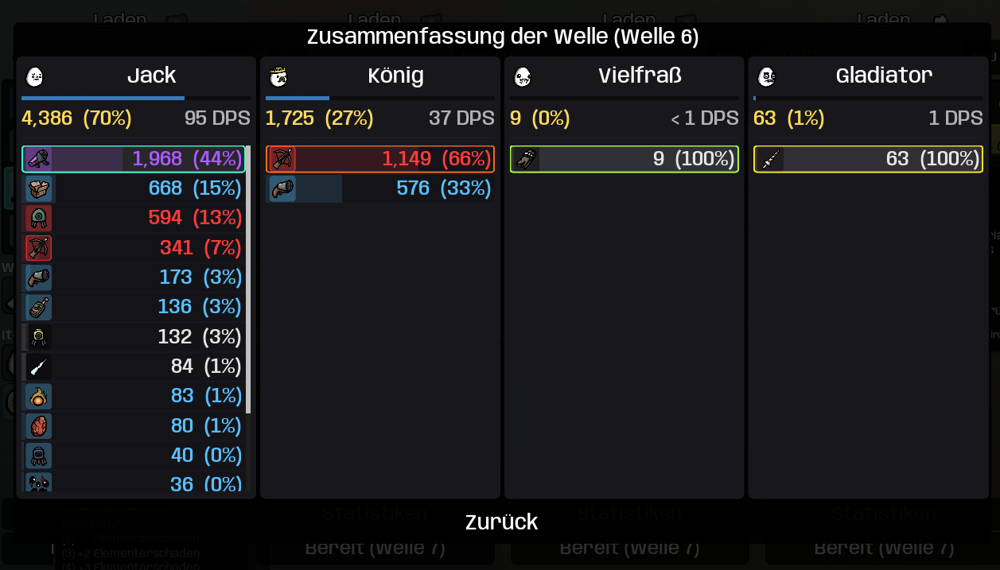

# DamageMeter for Brotato

A comprehensive damage tracking mod for Brotato that displays real-time damage statistics for each player, including total damage dealt and the top damage sources (weapons/items).

## Features

- **Total Damage Display**: Shows each player's total damage as a progress bar, with percentage relative to the highest damage dealer
- **Top Damage Sources**: Displays the top 6 damage sources (weapons, items, abilities) with their individual damage values
- **Damage Stats Screen**: View a full post-wave breakdown in the shop with per-player totals, DPS, and top sources
- **Item Grouping**: Automatically groups identical items (e.g., multiple turrets) and shows the count
- **Smart Tracking**: Tracks damage from:
  - All weapons
  - Damage-dealing items
  - Spawned entities (turrets from Wrench, landmines from Screwdriver, turrets from Pocket Factory, Dart Traps from Awl, Bleeding Turrets from Crowbar)
  - Pets (e.g. Bonk Dog, Bot-O-Mine)
  - Charmed enemies (Romantic, Flute, Virus and other charm effects)
  - Character abilities
- **Visual Indicators**: 
  - Item rarity colors (Common, Uncommon, Rare, Legendary)
  - Cursed item markers (purple flames)
  - Rounded icon backgrounds
- **Performance Optimized**: Intelligent caching system for smooth gameplay

## Installation

Install via [Steam Workshop](https://steamcommunity.com/sharedfiles/filedetails/?id=3578347192) or download from the repository.

**Optional:**
- **ModOptions** (Oudstand-ModOptions) - Enables in-game configuration UI
- Without ModOptions, the mod uses default settings and works perfectly fine

## Screenshots

*Real-time damage tracking showing total damage and top damage sources*

*Configuration options in ModOptions menu*

*Post-wave damage stats screen in the shop with full damage breakdown*

## Configuration

**With ModOptions (Optional):**

If you have ModOptions installed, configure all settings in-game via **Options → Mods → DamageMeter**:
1. Go to **Options → Mods → DamageMeter**
2. Adjust settings with sliders and toggles
3. Changes are saved automatically and persist across game restarts
4. Changes apply instantly without needing to restart

**Available Settings:**
- **OPACITY** (0.3-1.0): Transparency of all UI elements (default: 1.0)
- **NUMBER_OF_SOURCES** (1-25): Number of top damage sources to display (default: 6)
- **SHOW_ITEM_COUNT**: Show count for grouped items (default: true)
- **SHOW_DPS**: Show damage per second (default: false)
- **SHOW_PERCENTAGE**: Show percentage values relative to top player, co-op only (default: true)
- **HIDE_DAMAGE_BAR_SOLO**: Hide damage bar when playing solo (default: false)
- **UNGROUP_WEAPONS**: Show each weapon separately instead of grouping identical weapons (default: false)
- **SHOW_WAVE_SUMMARY**: Show damage stats button in the shop (default: true)
- **AUTO_OPEN_WAVE_SUMMARY**: Automatically open damage stats in the shop (default: false)

**Without ModOptions:**

The mod works perfectly with default settings shown above. No configuration needed!

## How It Works

### Damage Tracking
- **Weapons**: Tracked via `dmg_dealt_last_wave` property
- **Items**: Tracked via `RunData.tracked_item_effects` for items with `DAMAGE_DEALT` tracking
- **Spawned Entities**: Automatically detects and tracks damage from:
  - Turrets (Wrench weapon)
  - Landmines (Screwdriver weapon)
  - Pocket Factory turrets
  - Dart Traps (Awl weapon) - the game itself does not record their damage, DamageMeter adds the tracking
  - Bleeding Turrets (Crowbar weapon)
- **Charmed Enemies**: Damage dealt by enemies you charmed is shown as one "Charmed enemies" entry
- **DPS**: Based on the played wave time, so pausing does not lower it

### Grouping System
Weapons are grouped by ID, tier (rarity) and cursed status; items by ID and tier.

This means 5 common pistols are grouped together, but a cursed pistol appears separately.
With **UNGROUP_WEAPONS** enabled, every weapon gets its own entry.

### Performance
- **Source Caching**: The mod caches which items/weapons a player has and only recalculates damage values
- **Selective Updates**: UI elements only update when their values change
- **Optimized Arrays**: Uses PoolArrays for better performance

### Display Logic
- Progress bars are relative to the highest damage dealer (100%)
- When Player 1 has 100 damage and Player 2 has 80 damage:
  - Player 1: 100% progress bar
  - Player 2: 80% progress bar
- Bars update dynamically as damage changes

### Damage Stats
- After each wave, damage data is saved and shown in the shop damage stats popup
- Includes total damage, DPS, and ranked top sources for each player
- Open it via the icon button next to reroll, or enable auto-open in settings
- In co-op, each player can navigate their own column with their own input device

## Dependencies

- **ModOptions** (Oudstand-ModOptions): Optional - Enables in-game configuration UI
  - Without it, the mod uses default values and works fine
  - Recommended for users who want to customize settings
  - Available in this repository

## Compatibility

- **Mod Loader Version**: 6.2.0+
- **Game Version**: 1.2.0.0+ (Primal Dread update)
- **Multiplayer**: Supports up to 4 players

When used with online multiplayer mods, damage statistics are calculated from
the local game's weapon and item counters. Different machines may show different
totals; DamageMeter does not synchronize damage statistics over the network.

## Known Issues

- Some modded items may not be tracked if they don't use standard damage tracking

## Credits

Created by Oudstand

## License

This mod is provided as-is for the Brotato community. Feel free to modify and share.

## Support

For bugs or feature requests, please create an issue on the project repository.

## Changelog

### v1.4.2
- Fixed the meter blocking mouse clicks on the upgrade screen, even while faded out

### v1.4.1
- **Fixed crash on game version 1.2.0.1**: since this hotfix, mods that extend the shop script (`base_shop.gd`) break the game at startup. The wave summary button is now added to the shop at runtime instead

### v1.4.0
- **Primal Dread support**: Charmed enemy damage is now tracked for Virus (evolved charm) and any item granting charm on hit
- Dart Traps (Awl) and Bleeding Turrets (Crowbar) are listed as their own damage sources, like Wrench turrets
- Dart Trap damage is now tracked at all: the game ships the Awl and Dart Trap structures without a tracking key
- Charm detection now uses the game's own lookup; damage bars refresh 4 times per second instead of 10 (less overhead)
- DPS now counts only played wave time (pauses no longer lower it), and the meter no longer resets the game's own Builder Turret counter
- Updated for game version 1.2.0.0

### v1.3.0
- **Bot-O-Mine support**: Landmine damage is now correctly attributed to Bot-O-Mine via a landmine extension
- **Bonk Dog support**: Explosion and melee damage from Bonk Dog is now tracked and displayed
- **Ungroup Weapons toggle**: New option to display each weapon individually instead of grouping by tier

### v1.2.0
- Fixed a startup parse error in the landmine tracking extension on some mod setups
- **Configuration System**: Full in-game configuration support with persistence
- Added Mod Options (dami-ModOptions) as optional dependency for config UI
- All settings configurable in-game when Mod Options is installed
- Works perfectly fine without Mod Options using default values
- Config changes are saved automatically and persist across game restarts
- Live config updates - changes apply instantly without restarting
- Custom config file support for advanced users
- Streamlined settings: removed rarely-used options (compact mode, animation speed, etc.)
- Added shop damage stats popup with post-wave damage breakdown

### v1.1.0
- Added Pocket Factory support
- Performance optimizations with intelligent caching
- Added item count display for grouped items
- Added DPS display option
- Added configurable settings (code-based)
- Fixed cursed item display bug
- Added rounded icon corners
- Improved damage filtering

### v1.0.0
- Initial release
- Basic damage tracking
- Top 6 damage sources display
- Multi-player support
